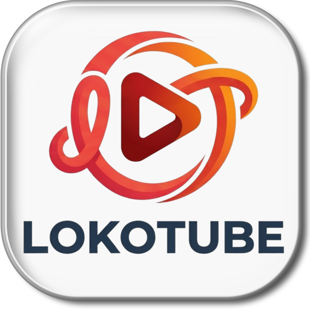

<div align="center">

# LokoTube



<br/>

**A lightweight YouTube and YouTube Music client with a modern Liquid Glass UI, ad-free playback, synced lyrics, and high-quality downloads for Android phones, tablets, and TV.**

[](https://github.com/monzterz/LokoTube/releases/latest)
[](https://github.com/monzterz/LokoTube/releases/latest)
[](LICENSE)

<br/>

[**Download Latest APK**](https://github.com/monzterz/LokoTube/releases/latest)

</div>

---

> **LokoTube is a fork of [LePlay](https://github.com/cnyel9/leplay) by [Levi Setiadi (@cnyel9)](https://github.com/cnyel9), continued and developed independently. The original author is credited below.**

## Features

- **Liquid Glass UI** — frosted-glass aesthetic across the player, Shorts, fullscreen controls, settings, and music mini player
- **Ad-Free Playback** — ad-free YouTube and YouTube Music streaming
- **Music mode** — artist pages (tap a song's artist to open their songs & albums), radio/autoplay, equalizer + volume boost, synced lyrics
- **SponsorBlock & Return YouTube Dislike** — skip sponsor segments and bring back dislikes
- **Block channels** — long-press a video to hide a channel from Home & recommendations
- **High-Quality Downloads** — video & audio (MP3) downloads up to 4K / HDR, with bulk download
- **4K HDR Playback** — 4K HDR playback with a fixed-resolution quality lock
- **Background & PiP** — background playback, picture-in-picture, and a sleep timer
- **Mini player & widget** — two mini-player styles plus a home-screen widget with previous/play/next
- **Chapters & search** — video chapters, search, channels, playlists, community posts, and deep-link opening of YouTube links
- **Import / Export** — subscriptions (CSV) & local playlists (JSON)
- **Multilingual** — Indonesian & English, extensible
- **Android TV Support** — dedicated TV mode with full D-pad remote navigation

---

## Download

[**Download Latest APK**](https://github.com/monzterz/LokoTube/releases/latest)

> Android 7.0+ · One universal APK for phones, tablets, and Android TV.

---

## Disclaimer

LokoTube is an independent, open-source project and is **not affiliated with or endorsed by Google LLC or YouTube**. All content is streamed directly from YouTube's servers for personal, educational use. Provided "as is" under the GPL-3.0 license without warranty; users are responsible for complying with YouTube's Terms of Service and applicable copyright laws.

---

## Build

Requires JDK 21 and the Android SDK (build-tools 36.1.0).

```bash
./gradlew assembleGithubDebug     # debug build (self-updater enabled)
./gradlew assembleGithubRelease   # signed release (GitHub flavor)
./gradlew assembleFdroidRelease   # F-Droid flavor (no self-updater)
```

APKs are written under `app/build/outputs/apk/<flavor>/<variant>/`.

---

## License

Original code Copyright (C) 2026 [Levi Setiadi (@cnyel9)](https://github.com/cnyel9). Licensed under GPLv3. See [LICENSE](LICENSE) and [COPYRIGHT](COPYRIGHT).

LokoTube modifications are also licensed under GPL-3.0.